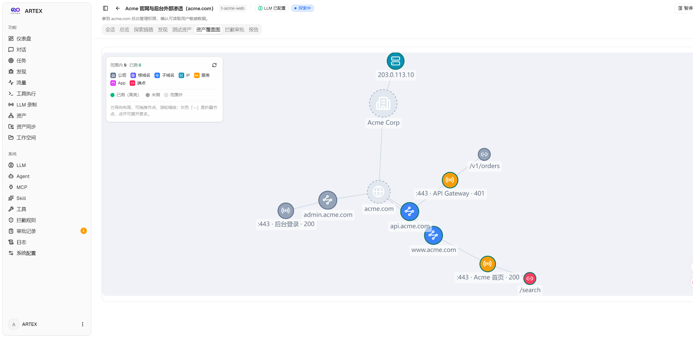
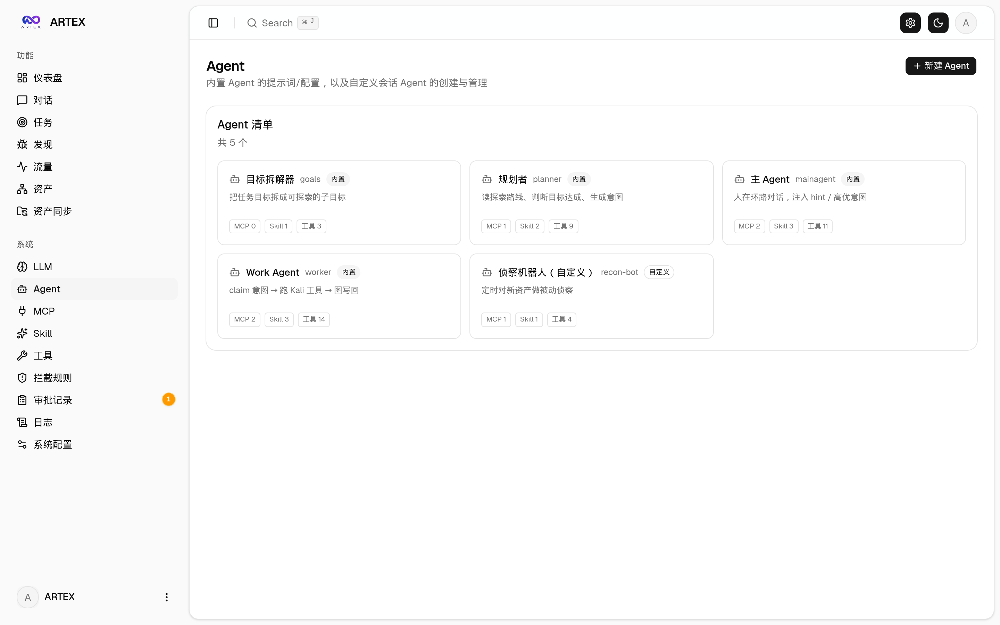
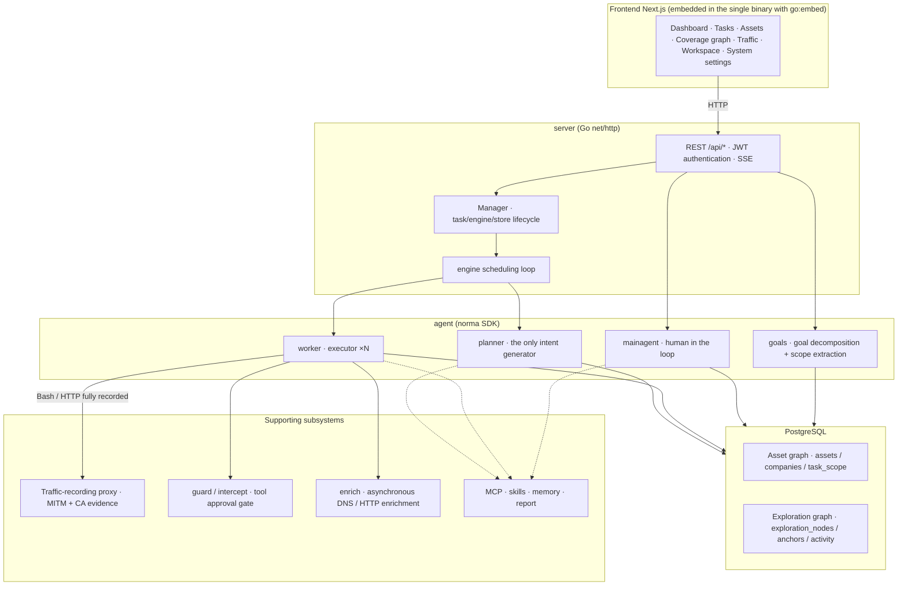
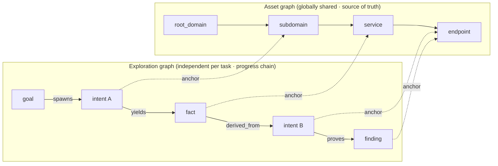
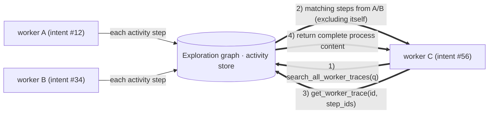
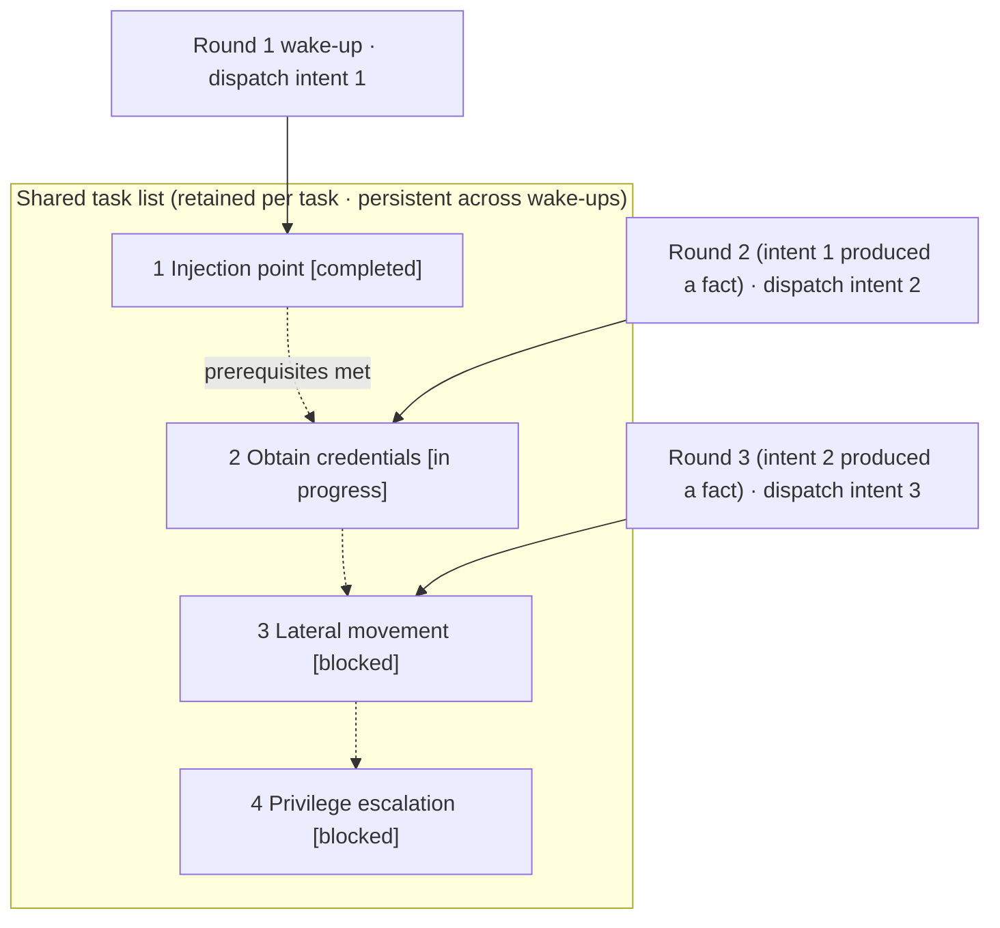

<div align="center">

# ARTEX

An autonomous AI penetration testing system powered by a Go backend and a Next.js frontend.

**Online demo (mock data):** [https://artex-demo.mhtsec.com](https://artex-demo.mhtsec.com)

**This repository is a source-code backup of the final ARTEX release. The original Docker image source, `autumn27/artex`, is no longer available. The image is now maintained by this repository as `mianhuatang11/artex` on Docker Hub. If pulling the image fails, run `docker compose build` to build entirely from source without external prebuilt dependencies.**

</div>

---

## Screenshots

> See the complete interactive experience in the [online demo](https://artex-demo.mhtsec.com). It runs entirely in the frontend with mock data and does not require a backend.

| Dashboard (overview / token usage / activity stream) | Task list |
| :---: | :---: |
|  |  |

| Task execution (sessions / tool calls) | Exploration graph |
| :---: | :---: |
|  |  |

| Findings | Assets |
| :---: | :---: |
|  |  |

| Asset coverage graph (force-directed layout, tested highlights, collapsible nodes) |
| :---: |
|  |

| Traffic recording | Human-in-the-loop chat |
| :---: | :---: |
|  |  |

| Agent management | LLM configuration |
| :---: | :---: |
|  |  |

| Intercept approvals | Backend logs |
| :---: | :---: |
|  |  |

---

## Approval Record Details

Global approval records, task-level intercept approvals, and approval cards in conversations can all be expanded to show detailed information. The layout is based on the [AegisHook approval detail component](https://github.com/RuoJi6/AegisHook/blob/main/web/src/components/CallDetail.vue), adapted to use ARTEX's components and theme.

## Asset Synchronization with ScopeSentry

ARTEX can synchronize asset data directly from [ScopeSentry](https://github.com/Autumn-27/ScopeSentry), eliminating duplicate asset collection:

- Enter the ScopeSentry address and API key on the **Asset Sync** page to add a data source.
- Select targets and asset types to synchronize by **project** or **task**. Supported types include domains, subdomains, IP addresses, ports, sites, and endpoints.
- Import the data in one step and merge it into the company asset scope. The resulting asset graph is immediately available for agent exploration.

---

## Installation

> ARTEX requires **PostgreSQL**. Exploration requires an **LLM** configured through `ANTHROPIC_API_KEY`, `OPENAI_API_KEY`, or the UI.

### Method 1: One-command installer (recommended)

```bash
git clone https://github.com/mhtsec/ARTEX.git
cd ARTEX
./install.sh
```

The script detects or installs Docker and lets you choose between **1. Full Docker** and **2. Local build and run**:

- **1. Full Docker:** Enter a PostgreSQL password, or press Enter to generate one randomly. The script writes `.env` and runs `docker compose up -d`.
- **2. Local run:** Choose whether to connect to an existing database or start one with Docker. The script generates `config.json`, compiles the embedded single binary with Go, and starts it.

When installation is complete, open **http://localhost:8787**. On the first visit, open `/setup` to set the administrator password.

### Method 2: Docker Compose (manual)

```bash
git clone https://github.com/mhtsec/ARTEX.git
cd ARTEX
cp .env.example .env          # Set POSTGRES_PASSWORD and optionally ANTHROPIC_API_KEY
docker compose up -d          # Pull the mianhuatang11/artex image and PostgreSQL
# → http://localhost:8787
```

> The original `autumn27/artex` image was removed from Docker Hub. The image is now maintained by this repository as **`mianhuatang11/artex`**.
> If the image source is unavailable, or you want to modify the code, build directly from source with `docker compose build && docker compose up -d`.
> The Dockerfile uses a multi-stage build (static frontend export → static Go compilation → runtime image), with dependency sources suitable for environments with limited external network access. Override them with `--build-arg GOPROXY=...` and/or `--build-arg NPM_REGISTRY=...` when needed.
>
> **A fresh clone does not run your checked-out source unless you build it.** The compose file sets *both* `image: mianhuatang11/artex:${ARTEX_TAG:-latest}` and `build:`, so Compose reuses the image whenever that tag already exists locally or can be pulled from Docker Hub — the `build:` section is skipped entirely. The result is that two machines running the same commit can serve different builds (for example, one running an image built locally from this source, the other still running the older image pulled from Docker Hub). To guarantee the container matches the source you cloned, always build explicitly:
>
> ```bash
> docker compose up -d --build     # build from the checkout, then start
> docker image prune -f            # drop the superseded image (optional)
> ```
>
> **Hosts without the Compose v2 plugin:** the commands above use `docker compose` (bundled with Docker 20.10+ / Docker Desktop). On hosts where only the standalone binary is installed, `docker compose up -d --build` fails with `unknown command: docker compose` or the misleading `unknown shorthand flag: 'd' in -d`. Check with `docker compose version`; if it errors, substitute the standalone binary instead: `docker-compose up -d --build`.

The image includes common tools such as ripgrep, curl, vim, npm, and nmap. The `./skills` and `./data` directories are persisted through bind mounts.

For remote MCP servers, select `http` (Streamable HTTP) or `sse` (legacy SSE) in system settings.

Legacy SSE services commonly establish an event stream with `GET /sse` and receive JSON-RPC requests through `/message?sessionId=...` returned by the service. Set the URL to `/sse` and configure the request header as `Authorization=Bearer <token>`.

### Method 3: Download a prebuilt binary (Releases)

Download the platform-specific zip from the original repository's [Releases](https://github.com/Autumn-27/ARTEX/releases). **This backup repository does not host binaries. If the original Releases page is also unavailable, use Method 2 or Method 4.** The extracted archive contains `artex`, `start.sh` (or `start.bat` on Windows), `skills/`, and `config.example.json`.

```bash
cp config.example.json config.json   # Configure the database connection
./start.sh                           # → http://localhost:8787
```

> Start ARTEX with `start.sh` or `start.bat` instead of running `./artex` directly. The script supervises the process and decides whether to restart it based on the exit code. **The [one-click page update](#method-1-one-click-page-update-recommended) flow depends on this wrapper.** If you run `./artex` directly, the process will not be restarted after an update.
> To run it in the background: `nohup ./start.sh >artex.log 2>&1 &`.

### Method 4: Build a single binary from source

```bash
# 1) Export the frontend as static files
cd web && npm ci && npm run build:static && cd ..
# 2) Copy the frontend into the embedded UI directory
cp -r web/out server/webui/dist
# 3) Build the binary (-tags embedui embeds the frontend)
CGO_ENABLED=0 go build -tags embedui -o artex ./cmd/artex
./start.sh
```

### Method 5: Build cross-platform release archives

`build.sh` builds and embeds the frontend, removes debugging information with the Go linker, and packages the release files as zip archives. Release mode generates archives for Linux amd64/arm64, macOS amd64/arm64, and Windows amd64 by default:

```bash
./build.sh --release
# Output: dist/artex-0.3.3-*.zip
```

UPX-packed self-extracting binaries may be incompatible with some Linux kernels, virtualization environments, or security policies, so UPX is disabled by default. Set `ARTEX_TARGETS` to customize the targets. If the target environment is known to be compatible, pass `--upx` to reduce the binary size further:

```bash
ARTEX_TARGETS=linux/amd64,windows/amd64 ./build.sh --release
./build.sh --target linux/amd64 --upx
```

---

## Updating

> Updates replace the program without touching your data. The PostgreSQL volume `pgdata`, `./data` (`jwt.key`, SQLite databases, and other data), and `./skills` are preserved. **No manual database migration is required:** every time `artex` starts, it idempotently reapplies `schema.sql`, including `ADD COLUMN` and `CREATE INDEX IF NOT EXISTS` statements. In any case, back up `./data` and the database before upgrading.

### Method 1: One-click page update (recommended)

On the **System Settings** page, open **System Settings** in the sidebar and use the **Version and Updates** card at `/system/settings` to check for and install new versions without logging in to the server.

After clicking **Update**, ARTEX downloads the release package for the current platform, verifies the Release `SHA256SUMS`, smoke-tests the new binary with `-h`, stages it as `artex.new`, exits, and lets `start.sh` or `start.bat` restart the process and complete the replacement. The page waits for the new version to become available and then refreshes automatically.

- **A failed update does not leave a broken executable:** failed verification or smoke tests discard the staged file and keep the current version running. If the new version fails to start three consecutive times after replacement, ARTEX automatically rolls back to `artex.old`. The failed version is retained as `artex.failed` for investigation.
- **Rollback is always available:** the previous version is retained as `artex.old`, and the card includes a **Rollback to previous version** action. Database schema changes are not rolled back.
- **Updates interrupt running tasks:** updating restarts the application, so perform updates while the system is idle.
- **Development builds cannot update:** updates are disabled when the version is `dev` or when `git describe` includes a suffix, preventing a release from overwriting a locally built debugging binary.
- **Docker updates replace the program, not the image:** tools such as Playwright and nmap inside the image do not change, and rebuilding the container with `docker compose up -d` restores the version included in the image. To update the image as well, run `docker compose pull artex && docker compose up -d artex`.
- If GitHub requires a proxy, configure the **global proxy** on the same page. The update flow uses it and downloads only from GitHub domains over HTTPS.

### Method 2: One-command update script

```bash
cd ARTEX
./update.sh
```

The script optionally runs `git pull`, then lets you choose between **1. Docker update** and **2. Local build update**, corresponding to the two `install.sh` modes:

- **1. Docker:** Specify the target image tag, or press Enter to keep the `.env` value of `ARTEX_TAG` (defaulting to `latest`), then run `docker compose pull` and `docker compose up -d`. The new image restarts and automatically migrates the schema.
- **2. Local:** Rebuild the static frontend, recompile `./artex`, and restart the process when the build completes.

### Method 3: Docker Compose (manual)

```bash
cd ARTEX
git pull                       # Update the compose file and scripts (optional)
# Specify a version by setting ARTEX_TAG=v0.2.0 in .env; otherwise latest is used
docker compose pull artex
docker compose up -d artex     # Restart with the new image and migrate the schema
docker image prune -f          # Remove old images (optional)
```

> The commands above deliberately **pull** the published image. If you instead run a build of your own checkout, skip `docker compose pull artex` and rebuild it: `docker compose up -d --build artex` — otherwise Compose restarts the previously built/pulled image and your changes never take effect (see Installation, Method 2).

### Method 4: Prebuilt binary (Releases)

Download the new release zip from [Releases](https://github.com/Autumn-27/ARTEX/releases), stop the old process, replace `artex` and `skills/`, and restart. Keep your existing `config.json` and `data/`:

```bash
cp -r <extracted-directory>/skills ./ && cp <extracted-directory>/artex ./
./start.sh
```

### Method 5: Build from source

```bash
git pull
cd web && npm ci && npm run build:static && cd ..
cp -r web/out server/webui/dist
CGO_ENABLED=0 go build -tags embedui -o artex ./cmd/artex
# Restart with ./start.sh
```

---

## Configuration

**Database** (`config.json`, or override it with the `ARTEX_PG_DSN` environment variable):

```json
{
  "database": {
    "host": "127.0.0.1", "port": 5432,
    "user": "artex", "password": "yourpass",
    "dbname": "artex", "sslmode": "disable"
  }
}
```

**LLM:** `export ANTHROPIC_API_KEY=sk-...` or `OPENAI_API_KEY`. You can also configure an LLM from the **LLM Configuration** page in the UI.

Optional variables: `ARTEX_LLM_PROVIDER`, `ARTEX_LLM_MODEL`, `ARTEX_LLM_BASE_URL`, and `ARTEX_LLM_PROXY`.

**Concurrency:** Configure the number of work agents per task in **System Settings**. The default is 3.

**Common options:** `./start.sh -addr :8787 -proxy :8788` configures the frontend/API port and the traffic-recording proxy port. The startup script passes arguments through to `artex` unchanged.

### Reverse proxy deployment (HTTPS / expose only port 443)

The frontend and API/SSE are served by the same backend port, `:8787` by default. The live activity stream uses a same-origin URL by default, so **`NEXT_PUBLIC_SSE_BASE` is not required**. Expose only port 443 publicly and keep port 8787 on the internal network.

SSE uses a long-lived connection with continuous server-side pushes. The reverse proxy **must disable buffering**; otherwise the browser may connect successfully but receive no events, and the activity stream will appear to spin indefinitely. Nginx example:

```nginx
server {
    listen 443 ssl;
    server_name your.domain.com;
    # ssl_certificate / ssl_certificate_key ...

    location / {
        proxy_pass http://127.0.0.1:8787;
        proxy_set_header Host $host;
        proxy_set_header X-Forwarded-Proto $scheme;

        # Required for SSE: disable buffering, use a long timeout, and HTTP/1.1
        proxy_buffering off;
        proxy_cache off;
        proxy_read_timeout 3600s;
        proxy_http_version 1.1;
        proxy_set_header Connection "";
    }
}
```

> Set `NEXT_PUBLIC_SSE_BASE` at **build time** only when SSE must use a different origin from the page, such as a separate subdomain. This variable is embedded into the static package during `next build`; setting it at container runtime has no effect.

---

## Development

### Manual finding retesting

The **Retests** tab in task details supports paginated selection of findings from the current task, previous conclusions and evidence, and manually starting a retest. After starting, the current tab remains open and shows a spinner with a **Retesting** state. Once a fix is confirmed, the finding status is updated accordingly.

Click **Retest** in the action area of any row in the findings list, or click **Start retest** in the **Finding Retest** section of a finding detail page. You may enter an optional fix version, test condition, or limitation. ARTEX creates an independent retest Agent session and keeps the current page open after starting. The flat list, task-grouped view, and asset view all support this entry point. While a retest is running, a spinner and **Retesting** state are shown; click the corresponding session to inspect it. The state returns to **Retest** when the session ends. Retesting does not restart the original scan task. Results are categorized as **Still reproducible**, **Fixed**, or **Unable to confirm**, and each result, piece of evidence, and session link is stored on the finding detail page.

On first startup, newer backend versions provision an editable **Finding Retester** Agent (`retester`). Configure its prompt, LLM, execution budget, and tools from Agent Management. It uses its bound LLM by default, or the globally active configuration when no LLM is bound. When a retest session completes successfully with a **Fixed** result, ARTEX automatically changes the finding status to **Fixed**. Running, failed, stopped, and other results preserve the original status. You can also select **Fixed** manually from the status dropdown. If the same finding is already being retested, ARTEX reuses the existing session. A stopped or failed session, or a session interrupted by a service restart, can be started again.

Historical retest records are available through finding details and sessions. They are not currently included in finding report exports or task archive packages, and are not automatically associated with traffic packages. Demo mode creates clearly marked mock records and does not send requests to real targets.

### Local development and testing

```bash
./dev.sh    # Backend (:8787) + traffic proxy (:8788) + Next.js dev server (:5173) → http://localhost:5173
```

- Backend: `go run ./cmd/artex` (without `-tags embedui`, the frontend is not embedded)
- Frontend: `cd web && npm run dev` (`/api` is proxied to the backend with hot reload)
- Tests: `go test ./...`
- Mock preview without a backend: `cd web && NEXT_PUBLIC_MOCK=1 npm run dev`
- Redeploy the online demo to Cloudflare Pages with a static export and mock data:
  ```bash
  cd web && NEXT_PUBLIC_MOCK=1 npm run build:static
  CLOUDFLARE_API_TOKEN=<token> npx wrangler pages deploy out --project-name=artex-demo --branch=main
  ```

---

## System Architecture

ARTEX is an **LLM-driven multi-agent autonomous penetration testing system**: a Go monolithic backend with an embedded Next.js frontend, PostgreSQL, and agent capabilities provided by the [`norma`](https://github.com/Autumn-27/norma) SDK (`agentcore`, `tool`, `permission`, `harness`, `memory`, and `transcript`). Its core is a **dual-graph architecture** supported by two autonomy mechanisms: process-level information exchange between workers and a planner with a shared multi-round task list for maintaining stable attack chains.

### High-level layers



| Layer | Responsibility |
| --- | --- |
| **Frontend** | Next.js static export embedded into the single binary with `go:embed`; visualizes tasks, assets, exploration chains, coverage graphs, and human-in-the-loop conversations |
| **server** | `net/http` routes, JWT authentication, and SSE; `Manager` owns the lifecycle of tasks, engines, and the database store |
| **engine** | One `plannerLoop` and N worker goroutines per task; intent claiming, timeouts, pausing, and draining |
| **agent** | goals, planner, worker, and mainagent; `ToolSet` exposes both graphs to the LLM as tools |
| **db** | PostgreSQL persistence for both graphs through pgx; the schema is idempotently created on every startup through `go:embed` |
| **supporting systems** | Recording MITM proxy, approval gate, asynchronous enrichment, MCP, skills, memory, and reporting |

### Dual-graph architecture: exploration graph + asset graph

The system separates **what the target is** from **how thoroughly it has been tested** into two independent graphs connected by anchors:

- **Asset graph (globally shared):** the cross-task source of truth for assets. Nodes include `root_domain`, `subdomain`, `ip`, `service`, `app`, and `endpoint`, each associated with a company. Parent-child relationships and deduplication keys from domain to subdomain, service, and endpoint are computed by the program; agents submit only raw information.
- **Exploration graph (independent per task):** the reasoning and progress of one task. Nodes include `goal`, `intent`, `fact`, `finding`, and `hint`. Edges such as `spawns`, `derived_from`, `yields`, and `proves` form a lineage chain that answers which directions came from which facts and what they produced.
- **The graphs are connected by anchors:** `exploration_anchors(node_id, asset_id)` anchors intents, facts, and findings to specific assets. This allows the system to show which assets an exploration direction targets and, from an asset, which intents tested it and which facts were discovered. It also powers **asset test coverage** and the **asset coverage graph**, which show in-scope assets and tested highlights.



> Responsibilities: **planner** reads the exploration graph state, evaluates goals, and adds **intents** to the frontier only when there are new uncovered directions. **worker** claims **one intent**, executes real tools, writes new assets, facts, and findings back to both graphs, and then stops. The asset graph is shared fact; the exploration graph is the progress chain for the current task.

### Engine and intent lifecycle (one exploration loop)

The engine is an **event-driven** loop: a graph change wakes the planner, the planner dispatches intents, workers claim and execute them, and their writes trigger the next round until the goal is proven with `prove_goal`.

```mermaid
sequenceDiagram
  autonumber
  participant EV as Graph-change debounce
  participant P as planner
  participant FR as Intent frontier
  participant W as worker
  participant PX as Recording proxy
  participant DB as Both graphs + activity

  EV-->>P: Wake up
  P->>DB: Read state (graph_overview prefetch + coverage/scope)
  P->>FR: Dispatch 0..N intents (with asset_ids)
  Note over P,FR: Most wake-ups dispatch 0 intents; no new direction means the round ends
  W->>FR: claimNext; claim one intent
  W->>DB: Fetch the raw assets for the intent's asset_ids as initial context
  W->>PX: Execute real tools (Kali / Bash / HTTP)
  PX-->>W: Response (fully recorded + CA verification)
  W->>DB: Write fact / asset / finding + activity for each step
  DB-->>EV: Graph changed
  EV-->>P: Wake up again (closed loop)
```

### Process-level information exchange between workers

During deep exploration, valuable observations such as an error message, response fragment, or hidden parameter may appear in one worker's **execution process** without becoming a formal fact. To avoid repeated work and let workers build on one another's results, workers can search the execution processes of other workers:

- `search_all_worker_traces(q)`: search the execution processes of other works in the current task by keyword. The current intent's steps are excluded automatically, and matches include `intent_id`.
- `list_worker_traces` / `get_worker_trace(intent_id, step_ids=[…])`: first list the works that have run, then retrieve the complete content of selected steps from a specific work.

Even when the exploration graph does not yet contain a corresponding fact, a later worker can reuse observations from another worker's process. Information therefore flows between workers at the **execution-process** level while the boundary remains unchanged: each worker still handles only the intent it claimed.



### Planner multi-round shared task list → stable attack chains

Real attack chains often consist of **multi-step sequences with dependencies**, such as discovering an injection point, obtaining credentials, moving laterally, and escalating privileges. Dispatching all of these in parallel would produce an incoherent result. The planner therefore maintains a **task-level planning list shared across wake-ups**:

- The planner is event-driven: a graph change wakes it, but **each wake-up starts a new session**. The shared task list lets it record a sequential exploitation chain once and dispatch intents step by step in subsequent rounds rather than expanding the entire chain in one round.
- Each round dispatches only the next step whose prerequisites are complete and whose required facts already exist. The planner updates the list as progress is made and marks steps complete when facts satisfy them.



As a result, the attack chain continues to progress **reliably, without duplication or incorrect ordering**, even in an event-driven environment with stateless sessions. This is a key capability that lets ARTEX autonomously complete multi-step exploitation chains.

---

## Community

Follow the **SecSentry** WeChat account and send a private message through the account to join the discussion group.

<div align="center">


</div>

---

## References

https://github.com/oritera/Cairn

## License and Disclaimer

### Open-source license

This project is licensed under the **GNU Affero General Public License v3.0 (AGPL-3.0)**. See the [LICENSE](LICENSE) file in the repository root for the complete terms.

You may freely use, modify, and distribute this project, but **derivative works must also be released under AGPL-3.0**. In particular, **if you modify this project and provide it to users over a network, such as by deploying it as an online service, you must make the corresponding complete source code available to those users**.

> **Important:** The open-source license itself does not restrict how the software may be used. The following **use restrictions** and **disclaimer** are additional requirements and statements from the author. Please follow them carefully.

**ARTEX is provided solely for personal education, code research, and local technical validation. It must not be used to perform actual testing against any online system or website.**

### Permitted use

- Reading, learning from, and researching this project's source code, and validating technical principles in an isolated local environment.
- Personal education, academic research, code review, and other non-adversarial activities.

### Prohibited activities

- **Do not use this tool to scan, probe, exploit, or attack any website, online service, or network-connected system**, regardless of whether you have authorization or own the asset.
- Do not use this tool for real-world penetration testing, offensive security exercises, adversarial operations, or production environments.
- Do not use this tool for unauthorized access, data theft, extortion, denial-of-service attacks, or any destructive or criminal activity.
- Do not use this tool for activities that violate the laws or regulations of any country or region.

### Compliance responsibility

Users are solely responsible for complying with all applicable cybersecurity, data protection, and computer-crime laws and regulations in their jurisdiction, including, where applicable, the Cybersecurity Law, Data Security Law, Personal Information Protection Law, and related judicial interpretations of mainland China. **Users bear all legal responsibility and consequences arising from their use of this tool.**

### Disclaimer

This project is provided **AS IS**, without warranties of any kind, express or implied. The authors and contributors are not liable for any direct or indirect loss, data loss, system damage, or legal dispute resulting from the use of this tool, whether or not it was used appropriately. **By downloading, installing, or using this project, you acknowledge that you have read, understood, and agreed to all of the terms above.**
